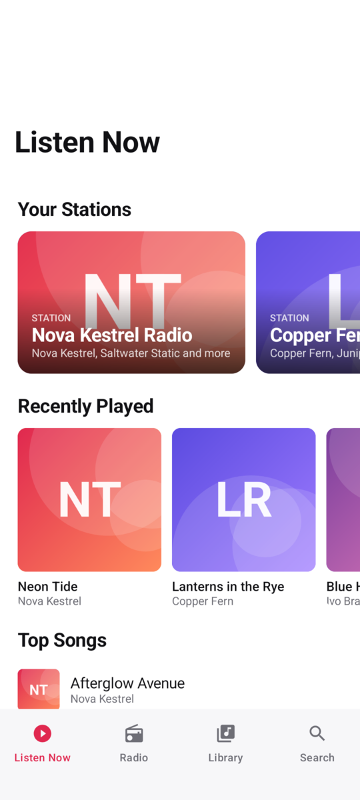
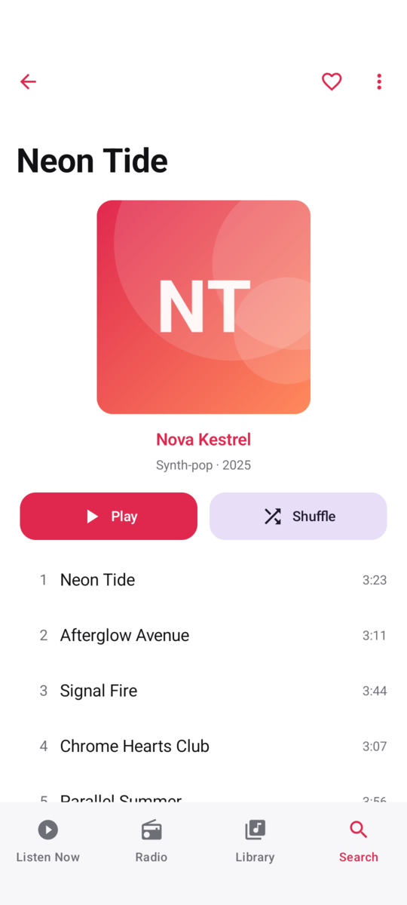
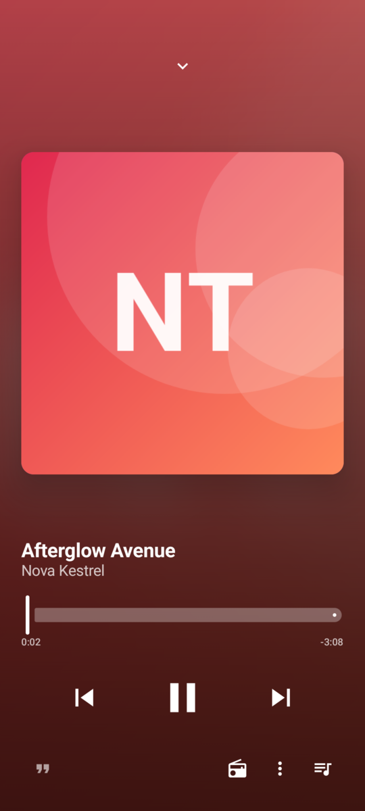
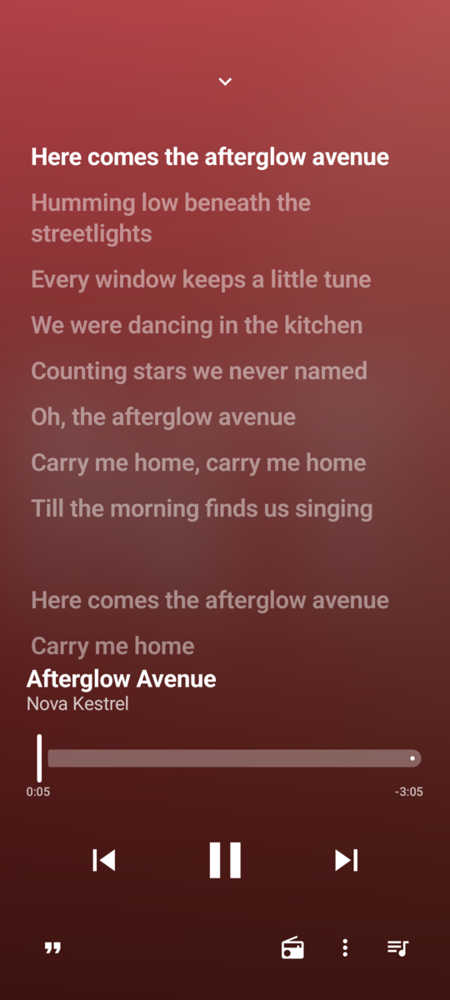

<!--
SPDX-FileCopyrightText: 2026 UltimateTunes contributors
SPDX-License-Identifier: GPL-3.0-or-later
-->

# UltimateTunes

Your own music streaming service, on your own hardware. Search for any song and it plays at once; from then on it lives in **your** library, tagged with proper metadata and cover art.

- **Server** (Docker): speaks the [OpenSubsonic](https://opensubsonic.netlify.app/) API, keeps a tagged library, and fetches from YouTube Music whatever it does not have yet, streaming it while it downloads.
- **Android app**: the player for your own server, which caches every song it plays to save mobile data, with offline downloads, synced lyrics, radio and playlist import.
- Works with other OpenSubsonic apps that search on the server.
- Multi-user, one revocable key per device, admin panel. Free software, no ads, no tracking.

  
  
  
  

Screenshots from the app's demo mode: every artist, song and cover is invented.

Part of the Ultimate family with [UltimateCalendar](https://github.com/qtekfun/UltimateCalendar), [UltimateTasks](https://github.com/qtekfun/UltimateTasks) and [UltimateDeck](https://github.com/qtekfun/UltimateDeck).

> Status: in development. See [SPEC.md](SPEC.md) and [PLAN.md](PLAN.md). For personal use: downloading from YouTube may be against its terms; do not offer this server to others.

## Self-host it on your homelab

UltimateTunes is meant for one household on hardware you control, reached over your LAN or a private network such as Tailscale; there is no public instance. Nothing is published yet (no images, no releases), so you build it yourself:

1. Build the server image: `docker build -f server/Dockerfile -t ghcr.io/qtekfun/ultimatetunes-server:local .`
2. Next to a copy of [`server/compose.yaml`](server/compose.yaml), write a `.env` with `UT_VERSION=local`, `UT_MUSIC_PATH=` your music folder and `UT_BIND=127.0.0.1:8044`, and two random secrets, `secrets/worker_token` and `secrets/admin_session_secret` (`openssl rand -hex 32` each). The file's header explains every setting.
3. `docker compose up -d` (migrations run first), then create the first admin once: `docker compose run --rm api bootstrap-admin <name>`.
4. Reach it over HTTPS from your devices, for example with `tailscale serve --bg 8044`. Keep it off the open Internet.
5. In the admin panel (`/admin`), create an API key for each device (it can show it as a QR code), build the app (`cd android && ./gradlew assembleDebug`, or a signed release, see [RELEASING.md](RELEASING.md)) and connect it with the server address and the key.

How the containers, networks and every connection fit together: [docs/architecture.md](docs/architecture.md).

Without a server, a debug build of the app has a demo mode (Connect screen, "Try the demo") with invented music.

## Contributing

See [CONTRIBUTING.md](CONTRIBUTING.md). Releases: [RELEASING.md](RELEASING.md). Privacy: [PRIVACY.md](PRIVACY.md). Security: [SECURITY.md](SECURITY.md).

## License

[GPL-3.0-or-later](LICENSE).
