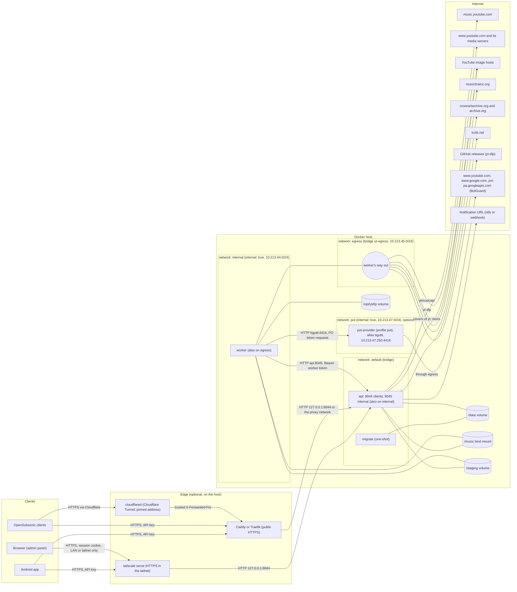
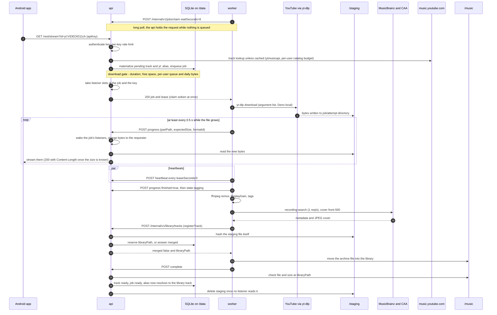
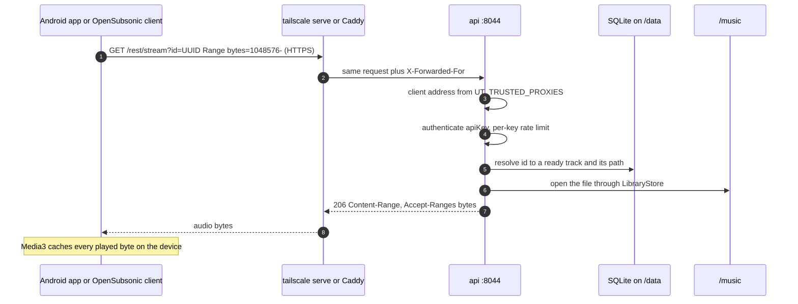
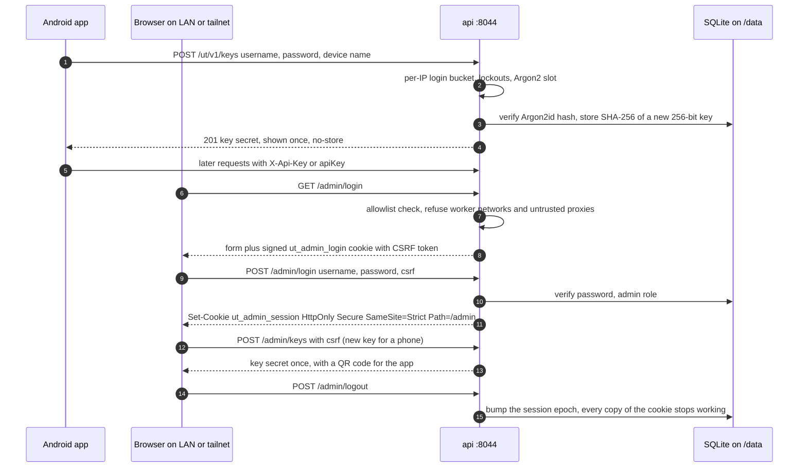
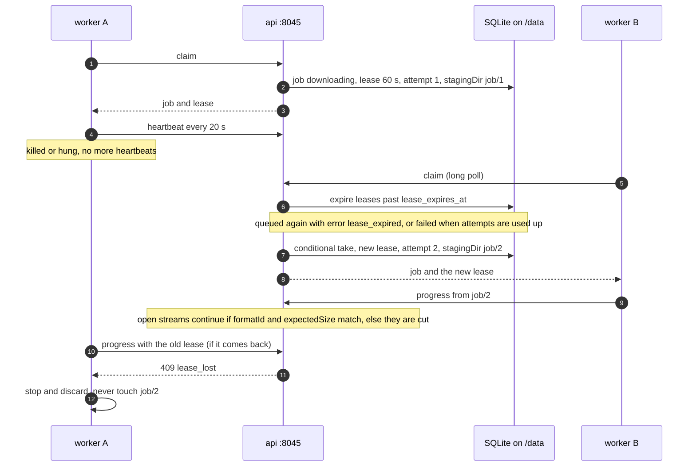

<!-- SPDX-FileCopyrightText: 2026 UltimateTunes contributors -->
<!-- SPDX-License-Identifier: GPL-3.0-or-later -->

# Container architecture and communications

How the server's containers are laid out, which networks and volumes they share, and every
connection that goes in or out of them. Everything here is read from the code and the compose
files on `master` (`server/compose.yaml`, `server/compose.test.yaml`, `server/Dockerfile`,
`server/src/ultimatetunes/`, `contracts/openapi/internal-worker.yaml`, `deploy/`); when a
comment and the code disagree, the code wins. Setting names are the env vars (`UT_*`); the
defaults are the code's. Host names are `example.org`/`example.com` placeholders and the subnets
are the repository's own defaults.

Related: [`SECURITY.md`](../SECURITY.md) (threat model), [`deploy/README.md`](../deploy/README.md)
(reverse proxies, firewall, backups), [`contracts/`](../contracts/) (the APIs themselves).

## 1. Overview

- **One image, three services**: `ghcr.io/qtekfun/ultimatetunes-server` runs as `migrate`
  (applies the SQL migrations and exits), `api` (the HTTP server, the only one with the
  database) and `worker` (downloads and tagging, no database).
- **The api has two listeners** on one app (`listeners.py`): the **client listener** on 8044
  (everything except `/internal/*`, which answers a plain 404 there) and the **internal
  listener** on 8045 (`UT_INTERNAL_PORT`; only `/internal/v1/*` and `/healthz`). Compose
  publishes only 8044, on `UT_BIND` (default `127.0.0.1:8044`).
- **The worker never talks to the database** and has no published port. It reaches the api only
  through `http://api:8045` (`UT_API_URL`) on the `internal` network and leaves to the Internet
  through its own `egress` network.
- **Optional PO token provider** (decision D13, off by default): with Compose's `pot` profile,
  a fourth container, `pot-provider` (upstream bgutil HTTP server, pinned by digest), mints
  YouTube proof-of-origin tokens for the worker's yt-dlp, which loads the matching bgutil plugin
  only when `UT_YTDLP_POT_PROVIDER_URL` is set. It shares the `pot` network with the worker only
  and leaves through `egress`; the api never sees it.
- **The Android app talks only to the server.** It never contacts YouTube, MusicBrainz, LRCLIB
  or any other host; it caches what it plays on the device (Media3 `SimpleCache`).
- **Edge**: the recommended setup is `tailscale serve` (HTTPS inside the tailnet, nothing public,
  `deploy/tailscale/README.md`). Public access only through Caddy (`deploy/caddy/Caddyfile`) or
  Traefik + Authelia (`deploy/traefik/`). A Cloudflare **proxy** may sit in front of Traefik
  when its ranges are listed in Traefik's `forwardedHeaders.trustedIPs`.
- **Cloudflare Tunnel** is supported as `cloudflared` → Traefik → api
  (`deploy/traefik-cloudflared/`), and is safe only under these conditions: `cloudflared` and
  Traefik have **pinned addresses** on their Docker network; Traefik trusts `X-Forwarded-For`
  **only from `cloudflared`'s address**; the api's `UT_TRUSTED_PROXIES` lists exactly those two
  `/32`s; and `UT_ADMIN_ALLOWED_NETWORKS` excludes the Docker and tunnel ranges, so `/admin`
  stays LAN-only (plus Authelia). What is never allowed is an **untrusted or unpinned** tunnel
  (or SSH forward, ngrok, Tailscale Funnel) in front of the edge: its traffic arrives from a
  private peer address that nothing attributes to a real client, so `/admin` and every per-IP
  limit would treat the whole Internet as the LAN (`deploy/README.md`, item 4).

## 2. Containers

From `server/compose.yaml` (production example) and `server/Dockerfile`. All three share the
`x-hardening` block.

| | `migrate` | `api` | `worker` |
|---|---|---|---|
| Image | `ghcr.io/qtekfun/ultimatetunes-server:${UT_VERSION}` | same | same |
| Command | `ultimatetunes migrate` | `ultimatetunes api` | `ultimatetunes worker` |
| User | `10001:10001` (`tunes`, no shell, no home) | same | same |
| Root filesystem | read-only, `/tmp` tmpfs | same | same |
| Capabilities | `cap_drop: [ALL]`, `no-new-privileges` | same | same |
| PIDs | 512 | 512 | 512 (yt-dlp, ffmpeg and Deno threads count) |
| Memory / CPU | none (one-shot) | `mem_limit: 768m`, `cpus: 2.0` | `mem_limit: 768m`, `cpus: 2.0` |
| Open files | default | `nofile` 4096 | `nofile` 1024 |
| Networks | `default` | `default`, `internal` | `internal`, `egress`, `pot` |
| Ports | none | `${UT_BIND:-127.0.0.1:8044}:8044` (8045 exposed in the image, never published) | none |
| Volumes | `data:/data` | `data:/data`, `${UT_MUSIC_PATH}:/music`, `staging:/staging` | `${UT_MUSIC_PATH}:/music`, `staging:/staging`, `ytdlp:/opt/ytdlp` |
| Secrets | none | `ut_worker_token`, `ut_admin_session_secret`, optional `ut_bootstrap_admin_password` (first start only) | `ut_worker_token` |
| Healthcheck | none | `GET http://127.0.0.1:8044/readyz` every 30 s (timeout 5 s, 3 retries, start period 10 s) | none |
| Restart | `"no"` | `unless-stopped` | `unless-stopped` |
| Starts after | | `migrate` completed successfully | `api` healthy |
| Logging | `json-file`, 10 MiB x 3 | same | same |

Notes:

- **Secrets** are Docker secrets mounted at `/run/secrets/<name>`; pydantic-settings reads them
  as the env var of the same name (`ut_worker_token` is `UT_WORKER_TOKEN`). The worker token
  needs 32+ characters in both containers; without it the internal API refuses every call.
  Without `UT_ADMIN_SESSION_SECRET` each api process signs sessions with a random key (warned),
  so sessions die on restart.
- **What each volume holds**: `/data` the SQLite database (WAL), the cover cache of external
  items and runtime settings (api only); `/music` the library, read and written by the api
  (library scans, deletes from the panel) and written by the worker (it moves finished files in);
  `/staging` partial downloads, one directory per job attempt (`<jobId>/<attemptSeq>`), written
  by the worker and read (streamed, cleaned) by the api; `/opt/ytdlp` the live yt-dlp zipapp and
  its verified updates, plus the worker's canary state file (worker only). The image also ships
  a read-only seed copy in `/opt/ytdlp-seed`, the pinned bgutil yt-dlp plugin, pruned to its HTTP provider, in
  `/opt/ytdlp-plugins` (loaded only with `UT_YTDLP_POT_PROVIDER_URL`), Deno in
  `/usr/local/bin/deno` and Debian's `ffmpeg` and `gpgv`.
- **`pot-provider`** (optional, Compose profile `pot`; not in the table because it is not our
  image): `docker.io/brainicism/bgutil-ytdlp-pot-provider:2.0.0` pinned by digest, the image's
  own user `1000:1000`, read-only root filesystem with a `noexec` 64 MiB `/tmp`, all
  capabilities dropped, `no-new-privileges`, `init`, `mem_limit: 512m` (about 80 MiB idle and
  115 MiB after minting, measured), `cpus: 1.0`, `pids_limit: 128`, `nofile` 1024, no port
  published, healthcheck `GET /ping` every 60 s. It listens only on its pinned address on `pot`
  (`UT_POT_PROVIDER_ADDRESS`, default `10.213.47.250`, port 4416), so nothing on `egress` can
  connect to it; the worker reaches it as `http://bgutil:4416`, an alias that exists only on
  `pot` (the service name `pot-provider` may resolve to its `egress` address). Its log is kept
  short (1 MiB x 2) because upstream prints every BotGuard integrity token it mints.
- **`migrate`** is a separate command so Kubernetes can run it as a Job later; the api only
  checks the schema version at start (`/readyz` fails while it is behind).
- **Other commands** of the same entrypoint, run by hand: `docker compose run --rm api ...` for
  `bootstrap-admin <name>` (first admin, password on the terminal), `scan-library` and
  `canary --only catalog`; `docker compose run --rm worker canary` for the full canary, since
  only the worker has yt-dlp (`/opt/ytdlp`) and talks to `www.youtube.com`.
- **Test stack** (`server/compose.test.yaml`): built from source (`ultimatetunes-server:test`, or the tag in `UT_TEST_IMAGE_TAG`; `tools/ci-local.sh` uses `ci-local`),
  `UT_FAKE_YOUTUBE=true` (fake catalog and fake downloader: nothing leaves the host), a fixed
  public worker token in the environment instead of a secret, the worker only on `internal` (no
  `egress`: it needs no Internet), `internal` not pinned (several test stacks run at once),
  named volumes for everything, no restart policy, only the worker memory-capped, and a
  faster api healthcheck (every 5 s).

## 3. Networks

| Network | Kind | Members | Purpose |
|---|---|---|---|
| `default` | Compose's project bridge, not pinned | `api`, `migrate` | The api's way out (YouTube Music, image hosts, LRCLIB, notifications) and the target of Docker's port publishing of 8044. |
| `internal` | `internal: true` (no route outside the host), subnet `UT_INTERNAL_SUBNET` (default `10.213.44.0/24`) | `api`, `worker` | The only network the worker shares with the api: `http://api:8045`. |
| `egress` | bridge, interface name `ut-egress`, subnet `UT_EGRESS_SUBNET` (default `10.213.45.0/24`) | `worker`, optional `pot-provider` | The worker's own way out (yt-dlp, MusicBrainz, Cover Art Archive, YouTube thumbnails, GitHub), and the optional PO token provider's (BotGuard hosts). Not shared with the api. The provider does not listen here. |
| `pot` | `internal: true` (no route outside the host), subnet `UT_POT_SUBNET` (default `10.213.47.0/24`) | `worker`, optional `pot-provider` (pinned at `UT_POT_PROVIDER_ADDRESS`, alias `bgutil`) | The worker's requests to the PO token provider (`http://bgutil:4416`). Empty without the `pot` profile. |
| `proxy` (Traefik example only) | external bridge, `UT_PROXY_SUBNET` (default `10.213.46.0/24`), Traefik pinned at `UT_TRAEFIK_ADDRESS` (`10.213.46.2`) | Traefik, `api` (alias `ultimatetunes-api`), Authelia | Traefik reaches `http://ultimatetunes-api:8044`. The worker never joins it. |

What can reach what:

- **Clients to the api**: only the published 8044, through `tailscale serve`, Caddy or Traefik.
  8045 is never published and listens only on the api's pinned address on `internal`
  (`UT_INTERNAL_HOST` = `UT_API_INTERNAL_ADDRESS`, default `10.213.44.250`), so containers on the
  api's other networks (a reverse proxy's shared network) cannot connect to it; on 8044,
  `/internal/*` is a 404.
- **Worker to the api**: `api:8045` over `internal`. The worker could also open 8044 on the api
  (same network), so the api refuses `/admin` and the `/readyz` detail to the worker's subnets
  (below).
- **Worker to the host and LAN**: the `egress` bridge can reach the host (and through it
  Caddy, a LAN-published `UT_BIND`, SSH) and the LAN unless the host firewall blocks it.
  `deploy/README.md` ("Firewall: the worker reaches the Internet only") gives the `iptables`
  rules on `ut-egress`: drop new connections to the host and to private ranges, allow the DNS
  resolver.
- **api to the worker**: never. The worker listens on nothing.
- **Worker to the PO token provider** (optional): `http://bgutil:4416` over `pot`, plain HTTP
  inside the host, no authentication (upstream has none). The api cannot resolve or reach it.
  The worker sends `POST /get_pot` with the video's content binding; the provider answers with a
  token (`GET /ping` checks it first). Upstream's request also carries proxy, source-address and
  TLS fields, which our yt-dlp never sets; a compromised worker could set them, but the provider
  can reach no more than the worker can already reach through `egress`.

**`UT_WORKER_NETWORKS`** (compose sets it to `UT_INTERNAL_SUBNET,UT_EGRESS_SUBNET`; the Traefik
overlay adds `UT_PROXY_SUBNET`): callers from these CIDRs never get `/admin` (403) or the
`/readyz` detail, even though the addresses are private and inside the default admin allowlist.
The worker runs yt-dlp on untrusted content, so it is treated as untrusted; a worker that reaches
the host's Caddy arrives with its real `egress` address forwarded, which this rule also refuses.
Residual (`SECURITY.md`): a connection from the worker to a host port published by Docker's
userland proxy reaches the api from the bridge gateway, which cannot be told apart from
`tailscale serve`; the host firewall and a narrowed `UT_ADMIN_ALLOWED_NETWORKS` close it.

**Client address and `X-Forwarded-For`** (`core/forwarded.py`, the outermost middleware):

- `UT_TRUSTED_PROXIES` (default empty) lists the CIDRs of proxies whose `X-Forwarded-For` is
  believed. The chain is read **from the right**, skipping trusted hops; the first untrusted hop
  is the client. Everything downstream uses that address: admin allowlist, `/readyz` detail,
  per-IP auth limits and lockout, audit log.
- Behind `tailscale serve` or Caddy on the host, set it to the single Docker bridge gateway the
  api sees (for example `172.18.0.1/32`, never a whole range). Behind the Traefik example it is
  exactly Traefik's pinned address, `10.213.46.2/32`.
- With it empty, a request that carries any forwarding header (`X-Forwarded-For`, `Forwarded`,
  `X-Real-IP`, `X-Forwarded-Host`, `X-Forwarded-Proto`) is refused by `/admin` and gets no
  `/readyz` detail: behind an unconfigured proxy every caller would look local.
- A Tailscale Funnel request (`Tailscale-Funnel-Request` header) never counts as a trusted
  network.
- The edges themselves trust no incoming `X-Forwarded-For` (Caddy without `trusted_proxies`,
  Traefik `forwardedHeaders.trustedIPs: []`): they are the edge and send the peer they saw.
  With Cloudflare Tunnel, the chain is client → `cloudflared` → Traefik → api: Traefik trusts
  the header only from `cloudflared`'s pinned address, and the api trusts both pinned
  addresses (`UT_TRUSTED_PROXIES`), so the client resolved is the one Cloudflare saw.

## 4. Communications catalogue

### Clients to the api (client listener, 8044)

| Flow | Protocol | Authentication | Purpose | Limits and caps |
|---|---|---|---|---|
| `/rest/<name>[.view]` (OpenSubsonic) | HTTP GET, HEAD, form POST | `apiKey` (query or form), or `u` + `p` where `p` is an API key (plain or `enc:`); token auth (`t`/`s`) refused with error 42; `apiKey` together with `u`/`p` is a conflict | Browsing, search, stream/download (with `Range`), covers, lyrics, playlists, scrobbles | Per key `UT_AUTH_KEY_RATE_PER_S` 50/s, burst `UT_AUTH_KEY_BURST` 200; failures lock the IP and username (below); form bodies 1 MiB |
| `/ut/v1/*` (own API) | HTTP JSON | `X-Api-Key` header or `apiKey` query (both and different: conflict) | `me`, keys, search, radio, listen now, track request and status, imports, server capabilities | Same per-key limit; bodies 4 MiB api-wide, import files 1 MiB |
| `POST /ut/v1/keys` | HTTP JSON | username + password in the body (Argon2id) | A new API key for a device, shown once (`Cache-Control: no-store`) | Body 16 KiB; per IP `UT_AUTH_LOGIN_RATE_PER_S` 0.2/s, burst 5; Argon2 slots and lockouts (section 6); the Traefik example routes it from LAN/tailnet only |
| `/admin/*` | HTTP (HTML + vendored HTMX) | Network allowlist, then signed session cookie `ut_admin_session` (`HttpOnly`, `Secure`, `SameSite=Strict`, `Path=/admin`, TTL `UT_ADMIN_SESSION_TTL_S` 8 h), CSRF token on every state change (`csrf` field or `X-CSRF-Token`, plus `Sec-Fetch-Site`); login form with its own signed `ut_admin_login` cookie | Users, keys (with QR code), jobs, library, notifications, yt-dlp, audit | `UT_ADMIN_ALLOWED_NETWORKS` (LAN + Tailscale by default), never `UT_WORKER_NETWORKS`, never through an untrusted proxy or Funnel; bodies 64 KiB; strict CSP |
| `/` | HTTP | none | Landing page | |
| `/healthz` | HTTP | none | Liveness: the process answers (no dependency checked) | Answered on both listeners |
| `/readyz` | HTTP | none | Readiness: database reachable, schema current, `/music` and `/staging` writable, enough free space | Status for everyone; per-check detail only to loopback and the admin allowlist (never the worker's networks or an untrusted proxy); cached 5 s; not routed by the Caddy and Traefik examples |

Every listener also caps connections (section 6). The Caddy and Traefik examples do not route
`/internal/*` or `/readyz` at all.

### Worker to the api (internal listener, 8045)

All calls: `Authorization: Bearer <UT_WORKER_TOKEN>`, compared in constant time; a missing or
wrong token gets the same `invalid_worker_token` problem. Paths are relative to the volume roots
and checked by the path sanitizer on both sides. The worker's client times out after
`UT_API_TIMEOUT_S` (10 s) and retries idempotent calls up to `UT_API_RETRIES` (3) times after a
transport error or a 5xx.

| Call | When | Purpose |
|---|---|---|
| `POST /internal/v1/jobs/claim` | Loop, idle | Claim the next job with a lease (`leaseSeconds`, `UT_LEASE_S` 60). **Long poll**: the worker sends `waitSeconds` (`UT_CLAIM_WAIT_S`, 8); the api holds the request up to that, capped by `UT_CLAIM_MAX_WAIT_S` (25), answers as soon as a job is queued in that process and re-checks the database every `UT_CLAIM_POLL_S` (1 s). Empty: `204` with `Retry-After: 0` after a long poll, else `UT_CLAIM_RETRY_AFTER_S` (2). Before choosing, expired leases are returned to the queue. |
| `POST /internal/v1/jobs/{id}/heartbeat` | Every `heartbeatSeconds` (lease / 3, 20 s by default) | Extend the lease; the answer may carry `cancelRequested`. |
| `POST /internal/v1/jobs/{id}/progress` | At least every 0.5 s while the file grows, then on `tagging` | `partPath`, `finalPath`, exact `expectedSize` once known, `formatId`, `contentType`, `progressive`, `finished`. The api learns about growth only from these reports and wakes the job's listeners at once; bytes are charged to the requesting user. Also extends the lease. |
| `POST /internal/v1/library/tracks` (`registerTrack`) | After tagging, before touching `/music` | The api hashes the staging file itself, then either reserves `libraryPath` (`merged: false`) or answers that the recording is already in the library (`merged: true`). |
| `PUT /internal/v1/library/tracks/{id}/replaygain` | After an album gain rewrite | Recomputed ReplayGain of a track. |
| `POST /internal/v1/jobs/{id}/complete` | After the move into `/music` (or right after a merge) | The api checks the file at the reserved path and size, marks track and job `ready` (or applies the merge), releases the lease and cleans staging once nobody streams it. |
| `POST /internal/v1/jobs/{id}/fail` | Any failure, cancel, or shutdown mid-download | Releases the lease and reservation; retryable failures go back to `queued` with backoff (30 s, 2 min, 8 min, ±20 %), at most 3 attempts. |
| `PUT /internal/v1/workers/{id}/status` | On start and every `UT_STATUS_INTERVAL_S` (300 s) | Worker and yt-dlp versions and the last **canary** result (there is no separate canary endpoint); the answer carries pending admin commands (`update_ytdlp`, `run_canary`). |

Every call is safe to retry: `heartbeat`/`progress` are last-write-wins, `registerTrack` is keyed
by job and path, `complete`/`fail` return the stored result for the same lease, and a stale
lease gets `409 lease_lost` (the worker discards that job's work).

### Outbound (to the Internet)

The only hosts the server contacts (CLAUDE.md). The api leaves through `default`, the worker
(and the optional `pot-provider`) through `egress`; all need DNS.

| Container | Destination | Protocol | What and when | Limits and protections |
|---|---|---|---|---|
| api | `music.youtube.com` (ytmusicapi) | HTTPS | Search, album/artist/track lookups, radio, playlist imports, the daily catalog canary | Global bucket `UT_YTM_RATE_PER_S` 2/s, burst `UT_YTM_BURST` 6, wait at most `UT_YTM_MAX_WAIT_S` 3 s; per-request timeout `UT_YTM_TIMEOUT_S` 5 s; `UT_YTM_THREADS` 3; circuit breaker on 429/403/bot check (`UT_YTM_BREAKER_BASE_S` 300 s doubling to `UT_YTM_BREAKER_MAX_S` 3600 s); per-user budgets and import share (section 6); answers cached in `TtlCache`; `search3` waits `UT_SEARCH_EXTERNAL_TIMEOUT_S` 1.5 s then answers from the library; off with `UT_EXTERNAL_SEARCH=false` / `UT_RADIO=false` |
| api | `i.ytimg.com`, `lh3.googleusercontent.com`, `yt3.ggpht.com`, `yt3.googleusercontent.com` | HTTPS | Thumbnails of `yt:` items for `getCoverArt` | Only URLs the catalog returned (never client input), exact hosts, no redirects, `image/*`, 5 MiB counted while streaming, timeout `UT_COVER_FETCH_TIMEOUT_S` 10 s; disk cache under `/data` (`UT_COVER_CACHE_TTL_S` 30 days, `UT_COVER_CACHE_MAX_BYTES` 512 MiB); an uncached fetch costs the caller a catalog token |
| api | `lrclib.net` | HTTPS | Lyrics (`getLyricsBySongId`) | `UT_LYRICS_RATE_PER_S` 1/s, burst 2, for the whole server; timeout 5 s; 1 MiB body; misses cached `UT_LYRICS_NOT_FOUND_RETRY_DAYS` 7 days, failures backed off `UT_LYRICS_FAILURE_BACKOFF_S` 300 s |
| api | The admin's notification URL (ntfy topic or webhook) | HTTPS only | Failed downloads, failed canaries, low-disk pauses, swept every `UT_ADMIN_NOTIFY_INTERVAL_S` (60 s) | No credentials in the URL, no redirects, short timeout; the name is resolved before each send and refused if it points at loopback, link-local, unspecified or multicast; the URL is never logged; only one replica sends (compare-and-set cursor) |
| worker | `www.youtube.com` and the media servers yt-dlp is sent to | HTTPS | `yt-dlp` download of one video id (`^[A-Za-z0-9_-]{11}$`) into `/staging/<job>/<attempt>`; also the daily download canary (one fixed Creative Commons track, always deleted) | Argument list, no shell, minimal environment; Deno is the only JS runtime and runs locally (`--no-remote-components`); `--match-filter "duration<=UT_MAX_TRACK_DURATION_S"`, `--max-filesize UT_MAX_DOWNLOAD_BYTES`, socket timeout 20 s, whole run `UT_YTDLP_TIMEOUT_S` 600 s; on a block (429, bot check) the worker stops claiming for `UT_BLOCKED_PAUSE_S` 1800 s doubling to 14400 s |
| worker | `musicbrainz.org` | HTTPS | Recording search when tagging | One request per second for the whole worker (`musicbrainz:global`), the MusicBrainz User-Agent, timeout `UT_METADATA_TIMEOUT_S` 15 s, 503/429 retried; off with `UT_MUSICBRAINZ_ENABLED=false` |
| worker | `coverartarchive.org`, redirected to `archive.org` and its subdomains | HTTPS | Album cover (`front-500`) for the archived file | Redirects followed by hand (at most 3, HTTPS, only those hosts), `image/*`, JPEG, 5 MiB; a missing cover never fails a job |
| worker | YouTube image hosts (as above) | HTTPS | Cover fallback when Cover Art Archive has none | Exact hosts, no redirects, JPEG, 5 MiB |
| worker | `api.github.com`, `github.com`, `release-assets.githubusercontent.com`, `objects.githubusercontent.com` | HTTPS | yt-dlp self-update: latest tag, then `yt-dlp`, `SHA2-256SUMS`, `SHA2-256SUMS.sig` | Every `UT_YTDLP_UPDATE_INTERVAL_H` (24 h), after an extractor error at most every `UT_YTDLP_UPDATE_ON_ERROR_MIN_INTERVAL_S` (1 h), or on the admin's command; size-capped downloads; `gpgv` must report `VALIDSIG` with the pinned fingerprint, the zipapp's SHA-256 must match its signed line, then a smoke test before the `current` symlink is swapped; whole check bounded by `UT_YTDLP_UPDATE_TIMEOUT_S` 300 s; off with `UT_YTDLP_AUTO_UPDATE=false` |
| pot-provider (optional, profile `pot`) | `www.youtube.com`, `www.google.com`, `jnn-pa.googleapis.com` | HTTPS | BotGuard: the YouTube home page (challenge and config; `/youtubei/v1/att/get` as upstream's fallback), the BotGuard interpreter script the challenge names (served from `www.google.com`), and Google's `GenerateIT` integrity-token endpoint; then it mints PO tokens locally for each worker request. Hosts observed through a logging proxy on 2026-10-13 (D13) | Upstream code, not ours: pinned by digest, unauthenticated, reachable only from the worker; minters cached (integrity token about 12 h), so a run of downloads costs a handful of requests. With the provider on, the worker's yt-dlp also sends the token to YouTube with its own requests (above) |

Nothing else: Spotify playlists arrive as uploaded files, import URLs are only parsed for a
YouTube/YouTube Music playlist id (allowlisted hosts, no request to the URL), and the Android app
contacts only the server.

## 5. Sequences

### (a) First play of a `yt:` song (streaming while downloading)

If the size is unknown at the first report, the api streams chunked with `Accept-Ranges: none`.
A format whose index is at the end (`progressive: false`) is served only once finished. If the
job fails, open streams are cut and later requests get error 70 until a retry. A `HEAD` never
starts a download.

### (b) Library play with `Range`

A range starting past the end gets `416`; several ranges or a malformed header get the whole
file (`200`). A `yt:` id that is already archived resolves to its library track and is served
the same way.

### (c) Login, key creation and admin session

Devices can also get their key only from the panel's QR code, with `POST /ut/v1/keys` kept
LAN/tailnet-only at the edge (Traefik example).

### (d) Worker lease expiry and retry

A lease-expired job is claimable at once (no backoff); retries after a reported `fail` wait
30 s, 2 min, 8 min. Each attempt writes only to its own staging directory, so a stale worker can
never write into a later attempt's file. A worker stopped with SIGTERM does not wait for its
lease: it releases a running download with a retryable `fail`.

## 6. Limits and protections

| Area | Setting (default) | Effect |
|---|---|---|
| Connections, client listener | `UT_LIMIT_CONCURRENCY` (128), `UT_KEEPALIVE_TIMEOUT_S` (5), `UT_BACKLOG` (256), `UT_MAX_HEADER_BYTES` (16 KiB) | 503 past the concurrency limit (a playing stream holds one); idle keep-alive closed; request heads capped. uvicorn has no header timeout: public access only behind Caddy (`read_header 10s`) or Traefik (`readTimeout 30s`). |
| Connections, internal listener | `UT_INTERNAL_LIMIT_CONCURRENCY` (32) | Same, for 8045. |
| Request bodies | `UT_MAX_BODY_BYTES` (4 MiB); OpenSubsonic form 1 MiB; import file 1 MiB; `POST /ut/v1/keys` 16 KiB; `/admin` 64 KiB | 413 before the app reads more. Edge: Caddy `/rest/*` 1 MB and 2 MB elsewhere; Traefik 2 MB on writes. |
| API keys | `UT_AUTH_KEY_RATE_PER_S` (50), `UT_AUTH_KEY_BURST` (200) | Per key, on every request. |
| Password checks | `UT_AUTH_LOGIN_RATE_PER_S` (0.2), `UT_AUTH_LOGIN_BURST` (5); `UT_AUTH_ARGON2_CONCURRENCY` (2), `UT_AUTH_ARGON2_WAIT_S` (2) | Per IP (IPv6 by /64); at most two Argon2 checks at once, 429 after the wait. |
| Lockouts and delays | `UT_AUTH_MAX_FAILURES_PER_IP` (10), `UT_AUTH_MAX_FAILURES_PER_USER` (5), `UT_AUTH_LOCKOUT_S` (900); `UT_AUTH_OUTSIDE_BACKOFF_BASE_S` (1), `UT_AUTH_OUTSIDE_BACKOFF_MAX_S` (300) | Failed attempts lock the IP. Usernames have separate counters for the admin networks (locked after 5 failures) and everyone else (a growing delay per consecutive failure, 1 s doubling to 5 min, reset by a success, never a lockout), so strangers can keep an outside sign-in waiting but never lock anyone out of LAN/Tailscale, sessions or API keys. Each attempt is reserved before Argon2, so parallel attempts get one guess per window. |
| Global auth brake | `UT_AUTH_MAX_FAILURES_GLOBAL_PER_MIN` (100), `UT_AUTH_GLOBAL_LOCKOUT_S` (60) | Too many failures from outside the admin networks lock unknown keys and the outside password checks of usernames with outside failures on record; valid keys and usernames that have not failed keep working. |
| Admin | `UT_ADMIN_ALLOWED_NETWORKS` (loopback, RFC 1918, link-local, ULA, Tailscale), `UT_WORKER_NETWORKS`, `UT_TRUSTED_PROXIES`, `UT_ADMIN_SESSION_TTL_S` (8 h) | Network gate before anything else; narrow the allowlist before any public exposure (`deploy/README.md`, item 6). |
| External search | `UT_SEARCH_USER_RATE_PER_S` (0.2), `UT_SEARCH_USER_BURST` (20) | Per user; past it, search answers from the library only (never an error). |
| Catalog lookups | `UT_CATALOG_USER_RATE_PER_S` (0.5), `UT_CATALOG_USER_BURST` (60) | Per user (anonymous callers share one bucket), for uncached lookups and uncached cover images; 429 past it. |
| Imports | `UT_IMPORT_CATALOG_RATE_PER_S` (0.5), `UT_IMPORT_CATALOG_BURST` (1), `UT_IMPORT_MAX_ACTIVE_PER_USER` (3) | All imports together take only this share of the YouTube Music budget; an import over a download limit waits for it instead of failing items. |
| YouTube Music (global) | `UT_YTM_RATE_PER_S` (2), `UT_YTM_BURST` (6), breaker 300 to 3600 s | Shared by every api request. |
| Downloads, per track | `UT_MAX_TRACK_DURATION_S` (1800), `UT_MAX_DOWNLOAD_BYTES` (200 MiB) | Longer tracks refused before anything is written (and by yt-dlp's match filter); larger files stopped. |
| Downloads, per user | `UT_MAX_QUEUED_JOBS_PER_USER` (200), `UT_MAX_DOWNLOAD_BYTES_PER_DAY_PER_USER` (5 GiB, rolling 24 h) | Checked at request and at claim; 429 with `Retry-After`; a job blocked for one user moves to the next requester who has allowance; one keep request starts at most 50 downloads. |
| Free space | `UT_MIN_FREE_BYTES` (2 GiB) on `/music` and `/staging` | Below it nothing is queued or claimed; resumes above 1.1 times the floor; logged, notified and shown in `/readyz`. |
| Listeners of an in-flight `yt:` stream | `UT_MAX_LISTENERS_PER_JOB` (8), `UT_MAX_LISTENERS_PER_KEY` (4), `UT_LISTENER_RETRY_AFTER_S` (5) | 503 with `Retry-After` beyond. |
| Shared cache | `UT_CACHE_MAX_ENTRIES` (200 000), `UT_CACHE_MAX_BYTES` (256 MiB), `UT_HOUSEKEEPING_INTERVAL_S` (600) | Expired entries purged and the cache trimmed oldest first; idle rate-limit buckets forgotten. |
| Lyrics, covers, MusicBrainz | See section 4 | Global buckets and size caps per upstream. |
| Containers | `mem_limit` 768m, `cpus` 2.0, `nofile` 4096 / 1024, `pids_limit` 512; optional `pot-provider` 512m, 1.0, 1024, 128 | Bounds a runaway process or tool. |

## 7. Scaling notes

v1 runs one api and one worker on Docker Compose; the code keeps the door open to several
replicas on Kubernetes (PLAN phase 5).

- **Shared state goes through interfaces** (`core/services.py`):
  - `TtlCache`: `SqliteTtlCache` (catalog answers, failure backoffs). Shared by every replica
    through the database already; Redis later.
  - `RateLimiter`: `SqliteRateLimiter` (every token bucket and lockout above). Also in the
    database, so limits hold across replicas.
  - `JobQueue`: `SqliteJobQueue`. A claim takes a job with a conditional update and checks the
    row count, so two replicas never hand out the same job; leases, heartbeats and idempotent
    calls let **workers scale horizontally**.
  - `InFlight`: `MemoryInFlight`, **in-process**. It deduplicates catalog calls and counts
    stream listeners, so with several api replicas the listener caps become per replica and
    duplicate catalog calls can happen once per replica, until a shared (Redis) implementation
    replaces it behind the same protocol.
- **What else is per process today**: the `JobWatch` that wakes streams on a worker report and
  the long-poll wake-up of `claim`. Both fall back to polling the database (streams every
  `UT_STREAM_POLL_INTERVAL_S`, 0.25 s; claims every `UT_CLAIM_POLL_S`, 1 s), so a report or a
  new job seen by another replica is picked up within that delay. The `/readyz` result cache is
  per process too.
- **Already replica-safe**: admin sessions are stateless signed cookies (every replica needs the
  same `UT_ADMIN_SESSION_SECRET`); the notification sweep and the scheduled canary claim their
  turn with a compare-and-set, so only one replica acts.
- **Storage**: every api replica and every worker must see the same `/music` and `/staging`
  (streams read staging files the worker writes), through `LibraryStore` and `StagingStore`: a
  shared volume, or an S3-compatible store later. `/opt/ytdlp` stays per worker.
- **Database**: the SQL is portable and CI applies every migration on SQLite and PostgreSQL;
  only SQLite ships in v1, which limits the api to one writer host. `migrate` becomes a Job.
- **Network**: the Docker networks become NetworkPolicies (the worker may reach only the api's
  8045 and the Internet; nothing reaches the worker), with the same `UT_WORKER_NETWORKS` and
  `UT_TRUSTED_PROXIES` rules for the pod and ingress CIDRs.
